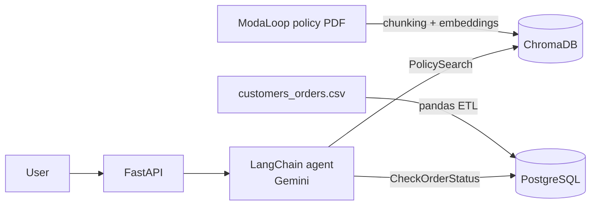

# Enterprise Support AI Engine

A hybrid AI customer-support assistant for a fictional online fashion store (**ModaLoop**).
The agent answers questions in two ways and decides on its own which one to use:

- **RAG over documents:** store policy, returns and logistics (PDF, Polish).
- **SQL lookup:** order status from a PostgreSQL database.

> **Status:** work in progress. The core pipeline works end to end; evaluation, authentication
> and tests are in progress (see [Roadmap](#roadmap)).
> All data (customers, orders, the ModaLoop policy) is **fictional**.

## Demo

[screenshot or GIF of the agent answering a policy question and an order-status question]

Example questions:

| Question | Tool used |
|---|---|
| "How many days do I have to return an item?" (in Polish) | `PolicySearch` (RAG) |
| "What is the status of order 120?" | `CheckOrderStatus` (SQL) |
| "What's the weather today?" | refuses, out of scope |

## Architecture



1. **ETL** (`app/etl_load.py`): loads and cleans order data with pandas and writes it to PostgreSQL.
2. **Vector store** (`app/vector_store.py`): splits the policy PDF into chunks, embeds them
   and stores them in ChromaDB.
3. **Agent** (`app/agent.py`): LangChain agent (Gemini) with two tools:
   `PolicySearch` (semantic retrieval) and `CheckOrderStatus` (parameterized SQL query).
4. **API** (`app/api.py`): FastAPI service exposing the agent.

## Tech stack

Python, LangChain, Google Gemini, ChromaDB, Hugging Face embeddings, PostgreSQL,
pandas, SQLAlchemy, psycopg2, FastAPI, Docker Compose.

## Design decisions

- **Fixed SQL tool instead of free-form text-to-SQL.** The agent never writes SQL;
  it can only call a parameterized query (`%s` placeholders), which removes SQL injection risk.
- **Scope-limited agent.** The system prompt restricts the assistant to store-related topics,
  and policy answers must be grounded in retrieved documents.
- **Source of truth for configuration.** Paths and settings live in `app/config.py`;
  secrets come from `.env`.

## Getting started

### Requirements
Python 3.12+, Docker, a Google AI Studio API key.

### Setup

```bash
git clone https://github.com/krystiangajdur/Enterprise_Support_AI_Engine.git
cd Enterprise_Support_AI_Engine
python -m venv venv
venv\Scripts\activate          # Windows; on Linux/macOS: source venv/bin/activate
pip install -e .
cp .env.example .env           # then fill in your values
docker compose up -d           # starts PostgreSQL
```

### Run (always from the project root)

```bash
python -m app.etl_load          # load orders into PostgreSQL
python -m app.vector_store      # build the ChromaDB index from the PDF
python -m app.agent             # run the sample questions in the terminal
uvicorn app.api:app --reload    # start the API on http://127.0.0.1:8000
```

### Environment variables

| Variable | Description |
|---|---|
| `GOOGLE_API_KEY` | Gemini API key |
| `DB_USER`, `DB_PASSWORD` | PostgreSQL credentials |
| `DB_HOST`, `DB_PORT`, `DB_NAME` | PostgreSQL connection |

## Project structure

```
app/
├── config.py        # paths and settings
├── etl_load.py      # CSV -> PostgreSQL
├── vector_store.py  # PDF -> ChromaDB
├── agent.py         # tools, prompt, agent
└── api.py           # FastAPI app
data/                # fictional orders (CSV) and policy (PDF)
```

## Evaluation

Planned: a test set of ~40 questions (policy, order status, other customers' orders,
false claims, out-of-scope, unanswerable), measuring retrieval recall@k, answer correctness,
correct tool choice, latency and cost. Results will be added here.

## Roadmap

- [ ] Customer-scoped order access (authorization, read-only DB role)
- [ ] Multilingual embeddings and relevance threshold for retrieval
- [ ] Evaluation set and metrics
- [ ] Conversation memory
- [ ] Tests and CI (pytest, GitHub Actions)
- [ ] Dockerfile for the application
- [ ] Cloud deployment

## License

See [LICENSE](LICENSE).