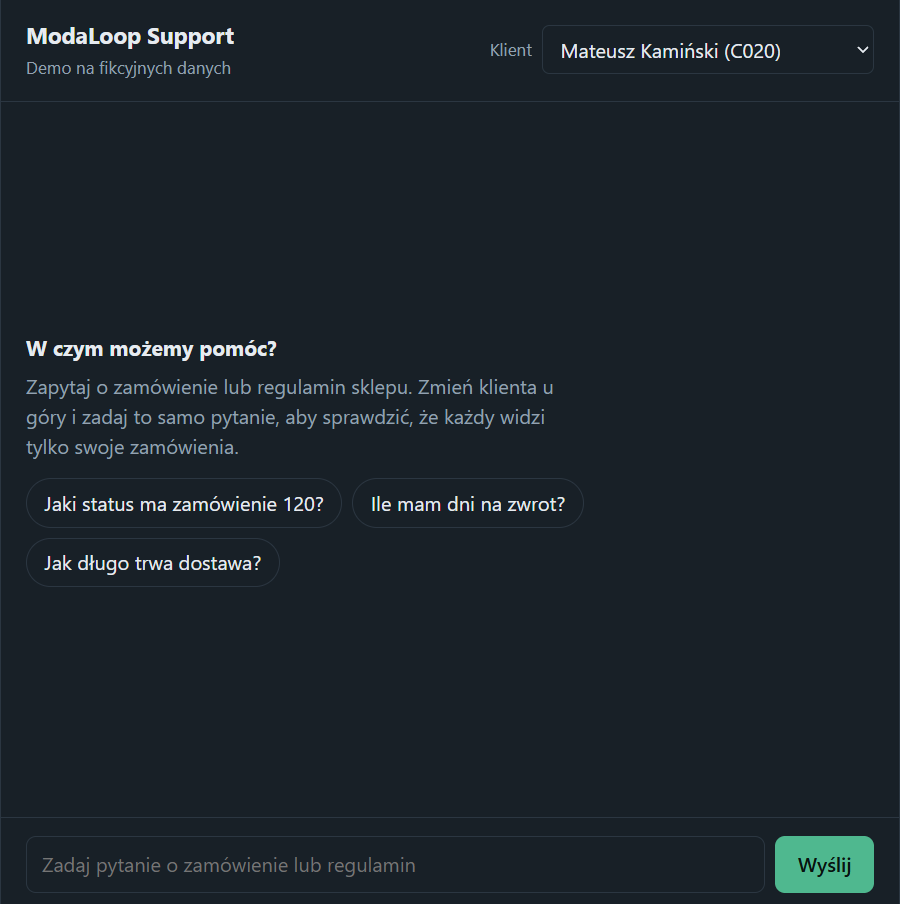
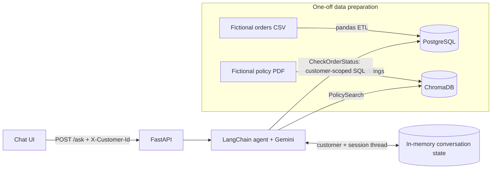

# Enterprise Support AI Engine

A hybrid, tool-using customer-support assistant for **ModaLoop**, a fictional Polish e-commerce store. A single LangChain agent decides whether to retrieve information from the store's policy document or query a customer-scoped orders database.

The project covers the workflow from data ingestion to a usable service: ETL, vector indexing, retrieval-augmented generation (RAG), a Gemini-powered agent, conversation memory, a REST API, a small chat UI, Docker, automated tests, and an evaluation suite.

> **Project status:** The application runs end to end with Docker Compose. Retrieval and agent evaluations have been completed, and their findings were used to improve the agent. GitHub Actions CI and cloud deployment remain future work.
>
> **Demo data only:** All customers, orders, and ModaLoop policy terms are fictional. Policy values are intentionally synthetic and must not be treated as legal advice or an accurate summary of Polish consumer law.



## Features

| Example question (Polish) | Agent behavior |
|---|---|
| "Ile mam dni na zwrot?" | Calls `PolicySearch`, retrieves relevant policy fragments from ChromaDB, and answers from the retrieved content. |
| "Jaki status ma zamówienie 120?" | Calls `CheckOrderStatus`, using a fixed PostgreSQL query restricted to the current customer ID. |
| The same order question from a different customer | Returns an order-not-found response rather than another customer's order details. |
| "A kiedy je kupiłem?" after discussing order 120 | Uses the context of the current conversation to identify the order and answer the follow-up. |
| "A kiedy je kupiłem?" without previous order context | Asks for the order number instead of guessing or reporting a database error. |
| "Jaki status ma zamówienie ABC-120?" | Asks for a numeric order ID without querying the database. |
| "Jaka jest dziś pogoda?" | Politely declines questions outside the store-support scope. |

## Architecture



1. **ETL — `app/etl_load.py`:** cleans `data/customers_orders.csv` with pandas and loads the `orders` table into PostgreSQL.
2. **Vector indexing — `app/vector_store.py`:** extracts text from the policy PDF, creates overlapping chunks, embeds them using a multilingual sentence-transformers model, and persists them in ChromaDB. The current sample policy produces 19 chunks.
3. **Agent — `app/agent.py`:** uses Google Gemini and two constrained tools: `PolicySearch` and `CheckOrderStatus`. Conversation state is checkpointed with LangGraph `InMemorySaver` and scoped by customer and session.
4. **API — `app/api.py`:** exposes the agent through FastAPI and serves the UI.
5. **UI — `app/index.html`:** provides a lightweight chat interface and a demo customer switcher.

## Tech stack

Python 3.12, LangChain, LangGraph, Google Gemini, ChromaDB, sentence-transformers (Hugging Face), PostgreSQL 15, pandas, SQLAlchemy, psycopg2, FastAPI, Uvicorn, pytest, Docker, and Docker Compose.

## Quick start (Docker)

### Requirements

- Docker with Docker Compose
- A Google AI Studio API key with available Gemini quota

### 1. Clone and configure

```bash
git clone https://github.com/krystiangajdur/Enterprise_Support_AI_Engine.git
cd Enterprise_Support_AI_Engine
cp .env.example .env
```

On Windows Command Prompt, use `copy .env.example .env`; PowerShell also supports `Copy-Item .env.example .env`.

Edit `.env` as described in [Configuration](#configuration). Never commit the file or a real API key.

### 2. Build and start

```bash
docker compose up -d --build
```

The first build and the first embedding-model download may take longer than subsequent runs.

### 3. Load sample data

```bash
docker compose exec app python -m app.etl_load       # CSV -> PostgreSQL (170 sample orders)
docker compose exec app python -m app.vector_store   # PDF -> ChromaDB
```

These are one-time initialization steps for empty volumes.

### 4. Open the application

- Chat UI: <http://localhost:8000/>
- API documentation: <http://localhost:8000/docs>
- Health check: <http://localhost:8000/health>

Database and index data are stored in Docker volumes. `docker compose down -v` removes them; run the loading commands again after resetting the volumes.

## Using the app

### Demo customer isolation

1. Select **Mateusz Kamiński (`C020`)** and ask: `Jaki status ma zamówienie 120?` The order is visible.
2. Switch to **Aleksandra Dąbrowska (`C021`)** and ask the same question. The order is not found for that customer.

This demonstrates SQL customer scoping, **not** production authentication. The customer selector and request header are intentionally user-controlled in the demo.

### REST API

`POST /ask` accepts a question and an optional `session_id`. The demo customer ID is passed in `X-Customer-Id`.

```bash
curl -X POST http://localhost:8000/ask \
  -H "Content-Type: application/json" \
  -H "X-Customer-Id: C020" \
  -d '{"question":"Jaki status ma zamówienie 120?","session_id":"my-session-1"}'
```

Example response shape:

```json
{"answer":"..."}
```

| HTTP status | Meaning |
|---|---|
| `200` | Response returned |
| `401` | Missing `X-Customer-Id` header |
| `422` | Invalid request body (for example, an empty question or one exceeding the configured limit) |
| `502` | The LLM service is temporarily unavailable |

Requests sharing the same customer and `session_id` continue a single conversation. On Windows, Swagger UI is convenient for testing requests without shell-quoting issues.

## Configuration

Configuration comes from environment variables (`.env` / `.env.example`), while paths and model settings are defined in `app/config.py`.

| Variable | Purpose |
|---|---|
| `GOOGLE_API_KEY` | Gemini API key |
| `DB_USER`, `DB_PASSWORD`, `DB_NAME` | PostgreSQL configuration |
| `DB_HOST` | Database host; Docker Compose uses the PostgreSQL service name |
| `DB_PORT` | Database port, normally `5432` |

The order-lookup tool uses a separate **read-only PostgreSQL role**, configured in the application. Keep all credentials out of version control.

## Project structure

```text
app/
├── config.py          # configuration
├── etl_load.py        # CSV -> PostgreSQL
├── vector_store.py    # PDF -> ChromaDB
├── agent.py           # tools, Gemini agent, conversation state
├── api.py             # FastAPI endpoints
└── index.html         # chat UI
data/                  # fictional orders and policy PDF
evaluation/
├── dataset.json       # conversational evaluation cases
├── evaluate.py        # agent evaluation runner
├── retrieval.py       # retrieval benchmark
├── chunks.json        # exported vector-store chunks
├── retrieval_gold.json # manually labeled relevant chunks
└── results/            # run reports (when retained locally)
tests/                 # pytest checks
Dockerfile
docker-compose.yml
pyproject.toml
```

Directory contents may vary depending on which generated evaluation outputs are kept in the repository.

## Running without Docker

```bash
python -m venv venv
# Windows:
venv\Scripts\activate
# Linux/macOS: source venv/bin/activate
pip install -e ".[dev]"
docker compose up -d postgres
python -m app.etl_load
python -m app.vector_store
uvicorn app.api:app --reload
```

Run commands from the project root so the `app` package is importable.

## Tests

```bash
python -m pytest -v
```

The database-backed tests require PostgreSQL and loaded sample data. The test suite covers customer-scoped access (owner versus another customer) and SQL-injection-related inputs. After the evaluation review, input-validation and conversation-clarification behavior were also identified as regression-test priorities.

## Design and security decisions

- **Constrained SQL access:** The agent never writes SQL. `CheckOrderStatus` uses a fixed, parameterized query with `WHERE order_id = %s AND customer_id = %s` and a read-only database role.
- **Customer scoping in code:** The request customer ID is captured by the order-tool closure rather than supplied as an LLM-controlled tool argument. The database query filters results by customer ID.
- **Input validation:** Order IDs must contain ASCII digits and represent a positive value within the supported database integer range. Invalid IDs are rejected before an SQL query.
- **Unambiguous order dates:** `order_date` means **order placement date**, not delivery date. A `Dostarczone` status alone does not establish an exact delivery date.
- **Conversation isolation:** Agent memory is scoped by both customer and session to prevent accidental context sharing between separate demo conversations.
- **Rendered text, not HTML:** The chat UI inserts responses as text rather than interpreting model output as HTML.
- **Grounding:** Policy responses are instructed to use retrieved policy context; order details come from the scoped SQL tool or its previously retrieved results within the active conversation.

**Security boundary:** Customer scoping is not equivalent to customer authentication. Because the caller controls `X-Customer-Id`, this demo must not be exposed with real customer data. A production service would derive identity from a verified authentication mechanism and enforce authorization server-side.

## Evaluation

The project uses two separate evaluations: **retrieval quality** for the RAG subsystem and **end-to-end conversational behavior** for the agent. A successful tool call is not, by itself, evidence that the final answer is complete or factually correct.

### 1. Retrieval benchmark

The policy PDF is split with `RecursiveCharacterTextSplitter` (`chunk_size=500`, `chunk_overlap=50`). The current sample yields **19 chunks** stored in ChromaDB and embedded with `paraphrase-multilingual-MiniLM-L12-v2`. Relevant chunk IDs were manually labeled for **11 policy queries** in `evaluation/retrieval_gold.json`.

| Retrieval metric | Result |
|---|---:|
| Recall@2 | **48.48%** |
| Recall@3 | **78.79%** |
| Recall@5 | **87.88%** |

These are mean query-level Recall@k scores on a small, manually labeled dataset, **not** answer-accuracy scores. Four additional candidate queries were not part of this labeled benchmark. The numbers apply to the evaluated corpus, chunk configuration, embedding model, and gold labels; they should not be generalized to larger policy collections.

### 2. End-to-end agent evaluation

`evaluation/dataset.json` contains **60 scenarios / 78 conversation turns** across six categories:

| Category | Scenarios | Turns | Focus |
|---|---:|---:|---|
| Policy | 15 | 15 | Grounded answers, procedures, missing information |
| Orders | 15 | 15 | Authorized lookups, unknown and malformed IDs |
| Memory | 10 | 22 | Follow-ups, context retention, topic switches |
| Isolation | 5 | 11 | Separate customers and sessions |
| Security | 10 | 10 | Foreign orders, prompt injection, SQL-like inputs |
| Scope | 5 | 5 | Refusal of unrelated requests |
| **Total** | **60** | **78** | |

Run from the repository root:

```bash
python -m evaluation.evaluate
```

The evaluation runner saves the question, answer, selected tools, latency, errors, and check outcomes for every turn. Tool Choice Accuracy is computed only where expected tool calls are specified; checks recorded as `NOT_EVALUATED` are **not** automated successes.

#### Full-run results

| Metric | Before changes (`74e558c011eb`) | After changes (`3c6c2a298151`) |
|---|---:|---:|
| Turns executed | 78 / 78 | 78 / 78 |
| Execution success rate | **100%** | **100%** |
| Tool Choice Accuracy (raw) | **100%** | **98.25%** |
| Turns with evaluated tool choice | 57 | 57 |
| Execution errors | 0 | 0 |
| Gemini rate-limit errors | 0 | 0 |

The post-change run contains **one tool-choice mismatch**: `order_alphanumeric`. The test still expected `CheckOrderStatus`, but the improved agent correctly requested a numeric order ID **without** calling the tool. The answer behavior improved even though the unchanged test expectation counted it as a failure. The original **98.25%** is preserved here for transparency. Updating `expected_tools` to `[]` would align the dataset with the new requirement; **100% after such a correction is a theoretical recalculation, not a separate executed evaluation result**.

A separate AI-assisted response review identified qualitative issues; these should not be reported as a fully automated factual-accuracy metric.

### 3. Evaluation-driven improvements

The first complete run succeeded at tool routing but exposed several answer-quality issues during response review. The changes below were then evaluated in the second complete run.

| Finding in baseline | Improvement | Observed after change |
|---|---|---|
| `ABC-120` generated a misleading database-connection error | Validate numeric `order_id` before SQL; clarify invalid-format handling | `order_alphanumeric` requests a valid numeric ID without a database call |
| A context-free question such as "A kiedy je kupiłem?" generated a misleading technical error | Ask for the order number when no unambiguous order exists in the current conversation | `memory_no_prior_order` requests clarification |
| The model described `2026-06-02` as a **delivery date** although it was an **order date** | Label order dates explicitly in the SQL-tool response and system prompt | `order_polite` correctly reports the order placement date and delivery status |
| An SQL-like order identifier could trigger an unhelpful technical-error response | Validate order identifiers and avoid interpreting malformed inputs as DB failures | `security_sql_injection` requests a valid number without revealing order data |

Multi-turn memory, customer/session isolation, and the sampled security/scope scenarios continued to behave as intended in the second run. **This is evidence from the tested scenarios, not a formal security audit.**

### 4. Remaining quality gaps

- Some retrieved-policy answers omit relevant details. For example, `policy_delivery_cost` lists domestic options but omits the fictional international delivery option (149 PLN).
- Recall@2 is lower than Recall@5, so answer completeness can depend on retrieval depth and the chunks selected.
- The evaluation currently measures tool choice and execution outcomes automatically; factual support, database-match checks, and many memory/security assertions still require separate review or dedicated automated validators.
- LLM outputs and request latency vary between runs. Gemini Free Tier has request quotas; pauses can help with short-window rate limits but do not increase the daily quota.

## Known limitations

- **Demo identity model:** `X-Customer-Id` is caller-supplied. There is no production-grade authentication or authorization of the asserted identity.
- **Synthetic corpus:** the policy is short, fictional, and deliberately includes non-realistic rules and numbers. The benchmark does not establish legal correctness or performance on real customer-support documents.
- **In-memory checkpointer:** conversation state is lost after restart and is not shared across independent application workers; retention is not configured for production.
- **Soft topic boundary:** out-of-scope refusals are controlled by the model prompt, not a hard enforcement layer.
- **Limited automatic answer grading:** `NOT_EVALUATED` checks do not contribute evidence of factual correctness.
- **Operational quotas and hardening:** there is no stated public-facing rate limiter, and Gemini API quotas can interrupt large evaluation runs. Do not publish this demo with real data and unrestricted access.

## Roadmap

- [x] Customer-scoped SQL order lookup and read-only database role
- [x] Input validation for numeric order identifiers
- [x] Conversation memory scoped by customer and session
- [x] RAG over a fictional Polish policy with multilingual embeddings
- [x] FastAPI and chat UI
- [x] Docker Compose setup
- [x] pytest access-control tests
- [x] Retrieval Recall@k benchmark and 60-scenario agent evaluation dataset
- [x] Full baseline and post-improvement evaluation runs
- [ ] GitHub Actions CI
- [ ] Optional cloud deployment / public demo

## License

See [LICENSE](LICENSE).
