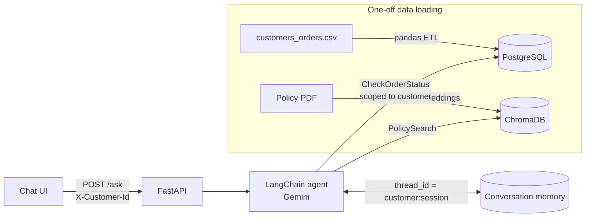

# Enterprise Support AI Engine

A hybrid customer-support assistant for a fictional online store (**ModaLoop**).
One agent answers two kinds of questions and decides on its own which source to use:

- **Policy questions** (returns, logistics, complaints): retrieval-augmented generation (RAG) over the store's policy document.
- **Order questions** ("what is the status of order 120?"): a SQL lookup in PostgreSQL, **scoped to the logged-in customer**.

The project covers the full path from raw data to a running service: ETL, vector indexing, an LLM agent with tools, conversation memory, a REST API, a small chat UI, tests and a containerised setup.

> **Status:** working end to end and runnable with a single `docker compose` setup.
> Evaluation, a read-only database role and CI are still in progress (see [Roadmap](#roadmap)).
> All data (customers, orders, the ModaLoop policy) is **fictional**.


## What it does

| Example question (Polish) | What happens |
|---|---|
| "Ile mam dni na zwrot?" | Agent calls `PolicySearch`, retrieves policy fragments from ChromaDB and answers from them. |
| "Jaki status ma zamówienie 120?" | Agent calls `CheckOrderStatus`, which queries PostgreSQL for **this customer's** order. |
| Same question asked as a different customer | The query returns no row, so the agent replies that the order was not found on the customer's account. |
| "A kiedy je kupiłem?" (follow-up, no order number) | Answered from conversation memory. |
| "Jaka jest dziś pogoda?" | Politely refused: the assistant only handles store-related topics. |

## Architecture



1. **ETL** (`app/etl_load.py`): reads `data/customers_orders.csv`, cleans it with pandas and writes the `orders` table to PostgreSQL.
2. **Vector store** (`app/vector_store.py`): splits the policy PDF into chunks (19 for the sample document), embeds them locally with a sentence-transformers model and stores them in ChromaDB.
3. **Agent** (`app/agent.py`): a LangChain agent backed by Google Gemini with two tools, `PolicySearch` and `CheckOrderStatus`, plus conversation memory.
4. **API** (`app/api.py`): FastAPI service exposing the agent and serving the chat page.
5. **UI** (`app/index.html`): a single-file chat page with a customer switcher.

## Tech stack

Python 3.12, LangChain, Google Gemini, ChromaDB, sentence-transformers (Hugging Face), PostgreSQL 15, pandas, SQLAlchemy, psycopg2, FastAPI, Uvicorn, pytest, Docker and Docker Compose.

## Quick start (Docker)

### Requirements

- Docker with Docker Compose
- A Google AI Studio API key (free tier is enough)

### 1. Clone and configure

```bash
git clone https://github.com/krystiangajdur/Enterprise_Support_AI_Engine.git
cd Enterprise_Support_AI_Engine
cp .env.example .env        # Windows (cmd/PowerShell): copy .env.example .env
```

Edit `.env` and fill in the values (see [Configuration](#configuration)).

### 2. Build and start

```bash
docker compose up -d --build
```

The first build takes several minutes (PyTorch and the LangChain ecosystem are large). Later builds are fast thanks to layer caching.

### 3. Load the data (one-off)

The database and the vector index start empty:

```bash
docker compose exec app python -m app.etl_load        # CSV -> PostgreSQL (170 orders)
docker compose exec app python -m app.vector_store    # PDF -> ChromaDB
```

The second command downloads the embedding model on first run, which can take a few minutes.

### 4. Open the app

- Chat UI: <http://localhost:8000/>
- Interactive API docs (Swagger): <http://localhost:8000/docs>
- Health check: <http://localhost:8000/health>

Data lives in Docker volumes, so it survives `docker compose down` and `docker compose up`. To reset everything, including the database and the vector index, run `docker compose down -v` and repeat step 3.

## Using the app

### Chat UI

Pick a customer in the top-right selector and start asking questions. Switching customers starts a new conversation. To see the access control in action:

1. As **Mateusz Kamiński (C020)** ask: "Jaki status ma zamówienie 120?" The order is shown.
2. Switch to **Aleksandra Dąbrowska (C021)** and ask the same question. The order is not found, because it belongs to someone else.

### API

`POST /ask` takes the question in the body and the customer identity in the `X-Customer-Id` header:

```bash
curl -X POST http://localhost:8000/ask \
  -H "Content-Type: application/json" \
  -H "X-Customer-Id: C020" \
  -d '{"question": "Jaki status ma zamówienie 120?", "session_id": "my-session-1"}'
```

```json
{ "answer": "..." }
```

| Status | Meaning |
|---|---|
| 200 | Answer returned |
| 401 | Missing `X-Customer-Id` header |
| 422 | Invalid body (empty or longer than 1000 characters) |
| 502 | The assistant (LLM) is temporarily unavailable |

`session_id` is optional. Requests with the same customer and `session_id` share one conversation. On Windows PowerShell it is easier to use the Swagger page than to escape JSON for `curl`.

## Configuration

Settings come from environment variables (`.env`, see `.env.example`). Paths and model names live in `app/config.py`.

| Variable | Description |
|---|---|
| `GOOGLE_API_KEY` | Gemini API key |
| `DB_USER`, `DB_PASSWORD`, `DB_NAME` | PostgreSQL credentials and database name (used by both the database container and the app) |
| `DB_HOST` | `localhost` for local runs. Docker Compose overrides it to `postgres` inside the container |
| `DB_PORT` | PostgreSQL port (default `5432`) |

## Project structure

```
app/
├── config.py         # paths, model names, settings from the environment
├── etl_load.py       # CSV -> PostgreSQL
├── vector_store.py   # PDF -> ChromaDB
├── agent.py          # tools, system prompt, agent, conversation memory
├── api.py            # FastAPI app and chat page
└── index.html        # chat UI (single file)
data/                 # fictional orders (CSV) and store policy (PDF)
tests/                # authorization tests (pytest)
Dockerfile
docker-compose.yml    # PostgreSQL + the application
pyproject.toml
```

## Running without Docker

```bash
python -m venv venv
venv\Scripts\activate                 # Linux/macOS: source venv/bin/activate
pip install -e ".[dev]"
docker compose up -d postgres         # only the database in a container
python -m app.etl_load
python -m app.vector_store
uvicorn app.api:app --reload
```

Always run commands from the project root, as modules (`python -m app...`), so that the `app` package is importable.

## Tests

```bash
python -m pytest -v
```

The tests check access control against a real database, so PostgreSQL must be running with the data loaded:

- the owner sees their own order,
- another customer does not see it,
- an SQL injection attempt in the customer id returns nothing.

## Design decisions

- **Fixed SQL tool instead of free-form text-to-SQL.** The model never writes SQL. It can only call one parameterized query (`%s` placeholders), which removes SQL injection by construction.
- **Identity is enforced in code, not by the model.** The customer id comes from the request and is baked into the order tool, and the query filters on both `order_id` and `customer_id`. The model cannot see or change it, so it cannot be talked into returning someone else's data. Orders that do not exist and orders that belong to someone else produce the same answer.
- **Conversation memory is keyed by customer and session.** The thread id is `customer_id:session_id`, so one customer can never read another customer's conversation, even by guessing a session id.
- **Untrusted model output in the UI.** Answers are inserted with `textContent` (no `innerHTML`), so model output cannot inject markup into the page.
- **Grounded answers.** The prompt requires policy answers to come only from the retrieved fragments and order data only from the order tool.
- **Docker.** CPU-only PyTorch keeps the image small, dependencies are installed before the code to make use of layer caching, and named volumes keep the database, the vector index and the downloaded model across restarts.

## Retrieval and evaluation notes

- Embeddings: `paraphrase-multilingual-MiniLM-L12-v2` (earlier `all-MiniLM-L6-v2`),
  stored in ChromaDB.
- On the current test corpus (~2-page Polish terms & logistics policy),
  both models retrieved the correct chunks for the tested questions,
  so the difference was not measurable.
- Known limitation: the corpus is small, so retrieval quality is easy
  to get right. Planned: a larger multi-document corpus and an evaluation
  set (retrieval recall@k, answer correctness, tool choice, latency)
  to compare embedding models quantitatively.

## Known limitations

- **Customer identification is a demo simplification.** The id is read from an HTTP header, which anyone can set. In production it would come from a verified token (JWT or OAuth). Do not use real data with this setup.
- **Retrieval quality for Polish is limited.** The policy is in Polish, but the current embedding model is trained mostly on English. A multilingual model and a relevance threshold are planned, together with an evaluation set to measure the difference.
- **Conversation memory is kept in RAM.** It is lost on restart, grows without a limit and is not shared between multiple workers.
- **The topic scope is enforced by the prompt**, which is a soft control. Access to data is protected by code and the SQL query, not by the prompt.
- **No rate limiting.** Do not expose the service publicly with a real API key without adding it.

## Roadmap

- [x] Customer-scoped order access (customer id enforced in the SQL query)
- [x] Authorization tests (pytest)
- [x] Conversation memory
- [x] Simple chat UI
- [x] Dockerfile and Compose setup for the application
- [ ] Read-only database role for the agent
- [ ] Multilingual embeddings and a relevance threshold for retrieval
- [ ] Evaluation set and metrics (retrieval recall, answer correctness, tool choice, latency, cost)
- [ ] CI (GitHub Actions)
- [ ] Cloud deployment

## License

See [LICENSE](LICENSE).
